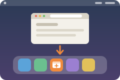

<p align="center">
  
</p>

# PWA Baker

<p align="center">
  <a href="https://studio.imbue.com/open?git_url=https://github.com/boweiliu/pwa-baker-template"></a>
</p>

Didn't work? Create a Studio workspace and paste this to your agent:
` /use-template https://github.com/boweiliu/pwa-baker-template`

## Why you care

A web page you use every day deserves its own window and Dock icon instead of a buried browser tab. PWA Baker makes that a one-line ask: tell your Studio agent the address, and a few seconds later there is a real Chromium web app on your Mac, with no clicking through Chromium's install flow.

## How to use it

**One-time setup (on your Mac).** You need Chromium in `/Applications`, Node (`brew install node`) and the Xcode command line tools (`xcode-select --install`). Then run this in Terminal; it builds the app and opens it in your menu bar:

```bash
git clone --depth 1 --filter=blob:none --sparse https://github.com/boweiliu/pwa-baker-template ~/code/pwa-baker-src \
  && cd ~/code/pwa-baker-src && git sparse-checkout set mac-apps/pwa-baker && mac-apps/pwa-baker/install.sh
```

**Connect your agent.** The first time you ask, the agent requests write access to the `~/PWA Baker` folder on your Mac through Studio's file sharing. Approve it, with syncing on if you can, so requests wait while your Mac sleeps.

**Ask for apps.**

- "Make a Dock app for https://linear.app" bakes it with the site's own icon.
- "Turn my Budget Studio app into a desktop app, name it Budget" bakes it using a picture from the workspace as the icon.
- "Remove the Budget app from my Dock" uninstalls it.

You can also bake from the app's own window on the Mac. A bake takes a few seconds; open Chromium web apps are closed and reopened for you when needed. `mac-apps/pwa-baker/docs/HOW-IT-WORKS.md` explains the design and `docs/OPERATIONS.md` covers logs and restarts.

## Ideas for making it yours

- Bake your own tools: give each Studio app you built its own Dock icon, using the share link as the address.
- Draw custom icons for your baked apps and pass them with `--icon` so the Dock looks the way you want.
- Ask the agent to rebuild your whole set of web apps on a new Mac from a list of addresses.
- Add a routine that checks the shared folder's `status.json` and tells you when the Mac app has stopped running.
- Extend the engine to bake a second browser's apps alongside Chromium.

## What this is

This repository is a published **Imbue Studio template**: a clean, bootable
snapshot of what an agent built, ready to adapt into your own. It is NOT the
generic workspace template -- it is this specific project.

[`template.md`](template.md) is the full manifest -- what it is, how it
works, what it needs to run, and what to adapt -- with the
machine-readable half (recipe, requirements, and the environment it needs
installed) in [`template.toml`](template.toml).
